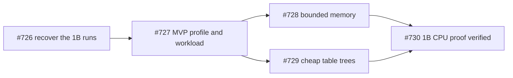
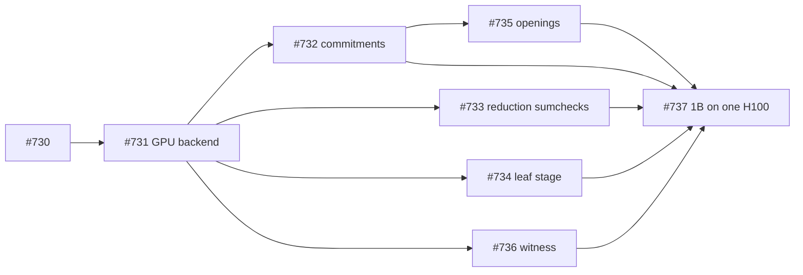
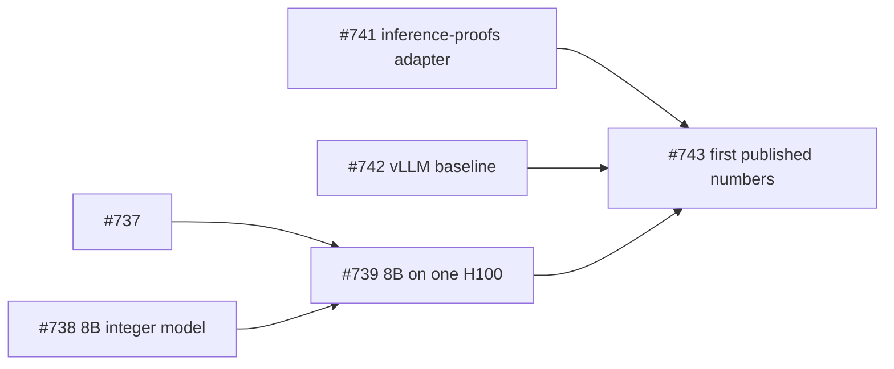

# MVP plan: a real model, one GPU, benchmarked

Status: active, set on 2026-11-09. It supersedes [IMPLEMENTATION.md](IMPLEMENTATION.md) as the order of work: that document remains the inventory of the full specification. The tracker is the epic [#722](https://github.com/AbdelStark/tessera/issues/722). Its sub-issues and "blocked by" links are the live dependency graph; this page is the reasoning behind it.

## The goal

A working end-to-end implementation that can be benchmarked against FlashProve:

- **The model.** A real Llama model, quantized and compiled by Tessera.
- **The proof.** Proven on one rented H100 or H200 and accepted by the independent verifier.
- **The benchmark.** Run through the [inference-proofs](https://github.com/ai-verification-observatory/inference-proofs) observatory's adapter, and reported in its units beside FlashProve and SASH.
- **After that.** Iterate on measured numbers until Tessera leads.

## Where we start

| | Today |
|---|---|
| Real models proven | None. The Llama-3.2-1B CPU attempts stalled more than 38 h into P2 (#617), and the planner charges a 2.5–3.8 TiB minimum ([EXP-0030](../../research/experiments/EXP-0030-real-runtime-sizing/README.md), #629, #641) |
| 8B integer model | Calibrated, not selected (#93) |
| GPU | Microkernels for `c_c`, `c_ℓ` and `c_π`, bit-exact against the CPU, measured on an H100 at `ρ` 4.49, 7.42 and 7.05: [v0.1 decision](../perf/v0.1/decision.md) |
| Pull-request CI | About 28 min on the prover job, about 10 min after #721 |

The benchmark to meet, from inferenceproofs.ai v0.1 (H200, one runner, marked not yet checked):

| System | Model | Prove time per token per Gbit | Proof size per token per Gbit | Overhead vs serving |
|---|---|---|---|---|
| FlashProve | Llama 4 Maverick, 17B active | 68.2 µs | 223 B | 61× |
| SASH | Llama 3.1 8B | 75.4 ms | 640 kB | 15,760× |

## Principles

1. **One narrow path first.**
   - **Protocol and workload:** `tessera-protocol/1`, non-interactive, `ni-100`, one workload matched to the observatory's (#727).
   - **Parked as `post-mvp`:** zero knowledge, Live sessions, audits, anchors, weight refresh, Û, and 70B or 405B. They stay in the specification and come back in Phase 4.
2. **Measure, then redesign.**
   - RFC-0020's measurement says the commitment, LogUp and tree levels need superseding designs.
   - Those designs are scored against the MVP's measured stage profile (#744, #745), not against projections.
   - Building the GPU path on the current protocol is how that profile gets measured. The production v0.5 GPU issues stay parked; the MVP's GPU issues take the narrow scope.
3. **Byte-identical GPU proofs.**
   - On tiny models, every GPU proof equals the CPU proof byte for byte.
   - The existing verifier tests and tamper corpus therefore cover the GPU path without new verifier work.
4. **Fast loops.**
   - Pull requests wait about 10 minutes, and 8 or fewer after #723. Slow suites run on `main` and nightly.
   - The MVP lane lets an implementation land before its specification note (#724).
   - GPU jobs run on rented H100s through one command (#740).
5. **Not negotiable:**
   - soundness review of anything that changes what the verifier accepts;
   - verifier independence (SP-6);
   - canonical encoding;
   - the Fiat–Shamir order;
   - test-only features failing release builds;
   - no secret in logs.

## Phases

The sub-issues of #722 hold each step's acceptance criteria.

### Phase 0: velocity

These run in parallel with everything else:

- the fast pull-request lane (#721, #723);
- the MVP build mode in AGENTS.md, CONTRIBUTING.md and the `issue-workflow` skill (#724);
- labelling every open issue `mvp` or `post-mvp` (#725);
- the vast.ai GPU runbook (#740).

### Phase 1: the first real proof, Llama-3.2-1B on the CPU

The point is not CPU speed. It is a verified real-model proof, to compare every GPU stage against. #727 decides how small the tables and working set can be at the workload. That decision drives both #728 and #729.

### Phase 2: the GPU prover MVP, Llama-3.2-1B on one H100

The backend moves one stage at a time, and each move is checked byte for byte against the CPU on tiny models. The microkernels of #718, #719 and #720 are the starting kernels for #732 and #734.

### Phase 3: the benchmark, Llama-3.1-8B against FlashProve

The MVP is done when #743 publishes Tessera's numbers in the observatory's units beside FlashProve's and SASH's, with each number's evidence level, and the adapter is submitted upstream.

### Phase 4: iterate to the state of the art

- **Per-stage profile and regression record (#744).** The instrument for everything after.
- **Redesign (#745).** The commitment, LogUp and tree levels, through the autoresearch loop and RFCs, scored on the measured profile.
- **Zero knowledge on the fast path (#746).** The claim neither FlashProve nor SASH states.
- **Scale (#747).** Multi-GPU and Maverick-class models, for a like-for-like comparison.

## What could stop this

| Risk | Where it bites | Response |
|---|---|---|
| The table side stays expensive at any workload | #729 | Restrict tables to the workload's ranges in the profile (#727), then the structured evaluation (#691) |
| Memory stays above one device at 8B | #728, #739 | Token groups and windows (RFC-0054, RFC-0055) are already specified; an H200 has 141 GB |
| The 8B integer model's fidelity is poor | #738 | Record it on the claim card; the benchmark compares proving cost, and #93 keeps the full gate |
| The overhead lands far above 61× | #743 | Expected at first: the v0.1 measurement says so. The profile turns it into a ranked list of stages to redesign (#744, #745) |
