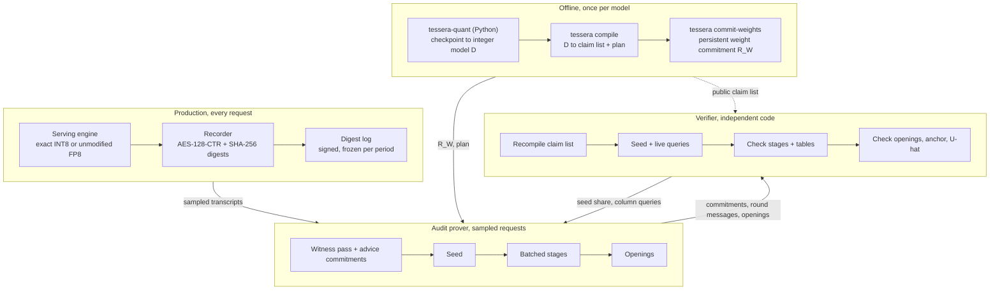

# 01 — Architecture

- Status: Accepted for v1 planning
- Governs: module boundaries, data flow, dependency rules
- Detailed in: [RFC-0001](../rfcs/RFC-0001-workspace-and-verifier-independence.md) (workspace), [RFC-0018](../rfcs/RFC-0018-gpu-prover-runtime.md) (runtime), [RFC-0019](../rfcs/RFC-0019-verifier.md) (verifier)

## 1. System context

Tessera has four lanes (source §7). The diagram and the prose below say the same thing.

**Offline.** The Python front-end turns a Llama-3.1 checkpoint into the integer model `D`. The Rust compiler turns `D` into a public claim list, which defines every table, and a prover-private execution plan. The prover commits the weights once into a persistent commitment with root `R_W`.

**Production.** The serving engine answers requests. Every transcript passes the recorder, which digests the encrypted stream and appends to a log. At the end of each period the log is frozen and signed before any sample is drawn.

**Audit prover.** For sampled requests the prover re-runs `D` (the witness pass), streams commitments to every non-arithmetic output, receives one seed, runs a fixed number of batched sumcheck stages and answers the verifier's live column queries.

**Verifier.** The verifier rebuilds every constraint from the public claim list with its own code, contributes randomness, checks every stage, the openings, the transcript anchor and the scoring bound, and returns a verdict.

## 2. Components

| Component | Language | Location | Responsibility | Specified in |
|---|---|---|---|---|
| Field | Rust | `crates/tessera-field` | Goldilocks `Fp`, quadratic extension `Fp2`, NTT roots, field traits | RFC-0002 |
| Codec | Rust | `crates/tessera-codec`, `crates/tessera-codec-derive` | Tessera Canonical Encoding (TCE) and its derive macros, artifact envelope, schema registry | RFC-0003 |
| Hash | Rust | `crates/tessera-hash` | Domain-separated BLAKE3, Merkle trees, chained column digests, Fiat–Shamir transcript, proof-of-work | RFC-0004 |
| Polynomials | Rust | `crates/tessera-poly` | Multilinear tables, `eq` tables, MLE evaluation, univariate round polynomials, masking helpers | RFC-0010 |
| Sumcheck | Rust | `crates/tessera-sumcheck` | Sumcheck engine, GKR layer protocols (matmul, product tree, generic), stage batching, masked variants | RFC-0010, RFC-0013 |
| Lookups | Rust | `crates/tessera-logup` | LogUp-GKR prover, multiplicities, tuple tables | RFC-0008 |
| Tables | Rust | `crates/tessera-tables` | Table registry and integer-only generators with pinned digests | RFC-0008 |
| Commitments | Rust | `crates/tessera-pcs` | Streaming advice commitment, persistent weight commitment, openings, hiding budget | RFC-0011, RFC-0012 |
| IR | Rust | `crates/tessera-ir` | Typed integer dataflow IR, claim-list types | RFC-0006, RFC-0007 |
| Compiler | Rust | `crates/tessera-compiler` | Range analysis, rescale placement, lowering, tiling, claim-list emission, commitment report | RFC-0006, RFC-0007 |
| Gadgets | Rust | `crates/tessera-gadgets` | Witness generation and constraint descriptions for requantization, softmax, brackets, sampling, AES, SHA-256 | RFC-0009, RFC-0015, RFC-0017 |
| Witness engine | Rust | `crates/tessera-witness` | CPU reference integer engine for `D` (bit-exact oracle), witness streaming interface | RFC-0018 |
| Scoring | Rust | `crates/tessera-scoring` | Sampler PRF stream, predictor definitions, `Û` accounting | RFC-0017 |
| Protocol | Rust | `crates/tessera-protocol` | Message types, session state machines, parameter sets, soundness calculator, audit sampling | RFC-0014, RFC-0016 |
| Anchor | Rust | `crates/tessera-anchor` | Digest-log formats, software reference recorder, log manifests | RFC-0015 |
| Prover | Rust | `crates/tessera-prover` | Orchestration of witness pass, commitments, stages, openings; CPU and GPU backends | RFC-0018 |
| GPU | Rust + CUDA | `crates/tessera-gpu` | Kernels, multi-GPU runtime, memory scheduler | RFC-0018 |
| Bench | Rust | `crates/tessera-bench` | Executable cost model, unit-cost microbenchmarks, reports | RFC-0020 |
| CLI | Rust | `crates/tessera-cli` | `tessera` binary | [02](02-public-api.md) |
| Verifier | Rust | `verifier/` (separate workspace) | `tv-field`, `tv-codec`, `tv-hash`, `tv-tables`, `tv-core`, `tv-transport`, `tv-cli` (`tessera-verify` binary); `tv-testkit` (test support, dev-dependency only) | RFC-0019 |
| Quantization front-end | Python | `python/tessera_quant` | Checkpoint import, calibration, W8A8 quantization, `D` export, integer reference, fidelity evaluation | RFC-0005 |
| Conformance vectors | Data | `spec/vectors/` | Cross-implementation test vectors and tiny models | [07](07-testing-strategy.md) |

## 3. Dependency rules

The prover crates form a DAG in this order (an arrow means "may depend on"):

`codec ← field ← hash ← poly ← {sumcheck ← logup, pcs, tables} ← ir ← compiler ← gadgets ← witness ← {scoring, anchor, protocol} ← prover ← gpu-backed prover features ← bench, cli`

Inside the braces, `logup` may depend on `sumcheck`, whose engine proves its fraction trees.

Rules, each enforced by a CI check ([RFC-0001](../rfcs/RFC-0001-workspace-and-verifier-independence.md#enforcement)):

- **DEP-1.** No crate under `verifier/` depends on any crate under `crates/`, directly or transitively.
- **DEP-2.** Crates under `crates/` may take verifier crates as `dev-dependencies` only, for differential tests.
- **DEP-3.** The verifier's third-party dependencies come from an allowlist ([RFC-0019](../rfcs/RFC-0019-verifier.md#dependencies)).
- **DEP-4.** Python and Rust do not link to each other in v1. They exchange TCE artifacts on disk, which keeps both sides independently testable against shared vectors.
- **DEP-5.** CUDA code is reachable only through `tessera-gpu`. Every crate builds and tests without a GPU; GPU paths sit behind the `gpu` cargo feature.

## 4. Lifecycle and artifacts

| Step | Actor | Input | Output artifact (schema, [03](03-data-model.md)) | Visibility |
|---|---|---|---|---|
| 1. Quantize | `tessera-quant compile` | Checkpoint, calibration set | `IntegerModel` (`D`), `CalibrationReport` | Secret (weights) |
| 2. Compile | `tessera compile` | `IntegerModel` | `ClaimList`, `ExecutionPlan`, `CommitmentReport` | Public, private, public |
| 3. Commit weights | `tessera commit-weights` | `IntegerModel` | `WeightCommitment` (public root `R_W` + private state) | Mixed |
| 4. Serve and record | Engine + recorder | Requests | `DigestLogEntry` stream | Public digests |
| 5. Freeze | Recorder | Entries of one period | `LogManifest` (signed) | Public |
| 6. Sample | Both parties | `LogManifest`, coin toss | `AuditSample` | Public |
| 7. Prove | `tessera prove` | Sample, transcripts, `D`, plan | `Round1`, `Round2Response`, `Round3Response` or `NiProof` | Protocol (hiding) |
| 8. Verify | `tessera-verify` | `ClaimList`, `R_W`, manifest, messages | `Verdict`, `AuditReport` | Public |

## 5. Prover phases

1. **Witness pass.** The witness engine runs `D` over the batch tile by tile. Each committed tensor is produced, Reed–Solomon encoded row by row, folded into chained column digests and freed ([RFC-0011](../rfcs/RFC-0011-advice-commitment.md)). Nothing larger than a tile stays resident.
2. **Round 1.** The prover sends the statement, which names `R_W` and its epoch, and the advice commitment. `tessera-protocol/2` adds the weight reservation and the masking-polynomial commitments ([RFC-0036](../rfcs/RFC-0036-protocol-messages.md#round1)). The anchor's key commitment is the session-open entry's ([RFC-0015](../rfcs/RFC-0015-transcript-anchor.md#frames)).
3. **Seed.** One seed arrives from coin tossing (live mode) or from the transcript with proof-of-work (non-interactive mode). Every later challenge derives from it.
4. **Stages.** About six batched sumcheck stages run, each over all layers, heads and query blocks with shared challenges ([RFC-0010](../rfcs/RFC-0010-proof-schedule.md)). Witness values are regenerated on tensor cores in each stage instead of stored.
5. **Openings.** Claims on committed tensors are batched to one point per commitment. Weights open through the folding pass; advice rows are recomputed in a second streaming pass to form combined rows. The verifier then sends live column queries, and a third streaming pass answers them by evaluating every row's codeword at the queried columns ([RFC-0018](../rfcs/RFC-0018-gpu-prover-runtime.md#pass-structure) P5).

## 6. Concurrency and determinism

- The CPU reference backend parallelizes with a work-stealing pool. Results never depend on scheduling: every reduction over field elements is exact, so order does not matter, and integer accumulation in the witness engine uses widths that cannot overflow.
- The GPU backend partitions work across the GPUs of one node by layer and head ([RFC-0018](../rfcs/RFC-0018-gpu-prover-runtime.md#partitioning)). Cross-GPU reductions are exact field additions.
- **INV-ARCH-1.** Given identical inputs, seed and masking randomness, the prover emits byte-identical messages on every backend and partitioning. Tests pin masking randomness through a test-only RNG seed.
- **INV-ARCH-2.** Prover control flow depends only on public data (shapes, claim list, parameters), never on secret values. Memory addresses depend on secret values only where the work is a function of the keys: counting multiplicities, and reading a table's dense core at a key. One exception (draft [RFC-0073](../rfcs/RFC-0073-weight-mask-expansion.md#the-stream), in effect when it is accepted): control flow and memory addresses may depend on which words of a stream of RFC-0004 a public, fixed acceptance test (`w < p`) rejects, where the test reads only the candidate word and a rejected word is discarded whole. The rejection pattern is then independent of every value any stream yields and of every other secret, so its timing and the addresses it moves reveal none of them. The pattern stays secret-class ([05 §3](05-observability.md#3-data-classification-and-redaction)). No other dependence on a secret-derived value is admitted. In `tessera-protocol/2`, every message a verifier can time is released on a schedule that public data fixes ([RFC-0018 'Release schedule'](../rfcs/RFC-0018-gpu-prover-runtime.md#release-schedule)). Proof timing therefore reveals nothing beyond the public statement, except, for a message that overruns its budget, which of the schedule's slots it took.
- **INV-ARCH-3.** No witness tensor larger than one tile is ever resident in host or device memory.
- **INV-ARCH-4.** Exactly one externally supplied seed exists per proof. Every challenge is a deterministic function of the seed and prior prover messages.
- **INV-ARCH-5.** Every artifact that crosses a process boundary is TCE-encoded inside a versioned envelope ([RFC-0003](../rfcs/RFC-0003-canonical-encoding.md)).
- **INV-ARCH-6.** Secret-class values never reach logs, metrics, error messages or reports ([05](05-observability.md#3-data-classification-and-redaction)).

## 7. Deployment view

| Host | Hardware | Runs |
|---|---|---|
| Prover node | One 8-GPU H100/H200/B200 node minimum; 405B needs about 405 GB of INT8 weights resident across GPUs | `tessera prove`, `tessera commit-weights` |
| Compile host | CPU, 512 GiB RAM for 405B checkpoints | `tessera-quant compile`, `tessera compile` |
| Verifier host | x86-64 or aarch64 CPU, 32 cores, 64 GiB RAM target | `tessera-verify` |
| Recorder | Network tap or attested NIC (external) | Digest log producer conforming to [RFC-0015](../rfcs/RFC-0015-transcript-anchor.md) |

The verifier host and the prover node belong to different parties and share no software.
