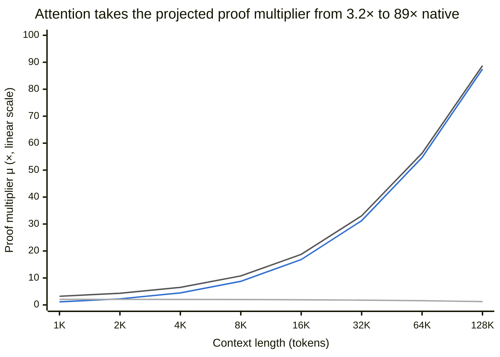
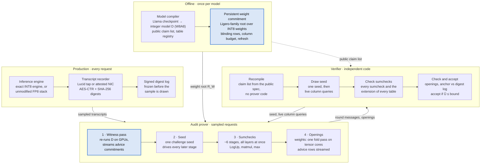

# Proofs of Inference at the Speed of Inference — SOTA, Limits, Path Forward

*15 October 2026*

## 1. Executive summary

Exact zero-knowledge proofs of frontier inference at a small multiple of inference cost look reachable. A sumcheck/GKR prover that commits only non-arithmetic outputs projects to about 3× native cost for 1K-token Llama-3.1-405B requests and about 19× at 16K, four to five orders of magnitude beyond the best published frontier-scale proof. "Sub-10%" is reachable as amortized treaty overhead, through committed transcripts and unpredictable request sampling, not as a per-request cost.

- **The real frontier is closed and smaller than advertised.** Attestable proves Gemma 4 31B at 53–77 tok/s on one H100, with 4–8 MiB proofs, sub-second verification and a 16K cap. That is a single-digit multiple of batch-one decode, not single-digit percent. Open systems trail by two to four orders of magnitude.
- **Cost lives in commitments and lookups, not FLOPs.** At 405B, linear layers cost about 2× native and get cheaper per FLOP as models widen. Attention costs about 200× native per score and dominates beyond roughly 2K tokens.
- **Tessera (working name)** keeps VerInf's statement and soundness discipline and replaces its cost structure. Matmuls and attention products stay virtual; tables absorb rescales; softmax is pinned by a max certificate at one lookup and one commitment per score; batched stages make proof depth independent of model depth; weights are opened by the same tensor-core pass that folds them.
- **Two modes, one circuit.** Bounded mode certifies an unmodified FP8 deployment; exact mode certifies token-for-token replay of a deterministic INT8 engine, which needs Hopper or B200-class serving.
- **One research problem decides the long-context story:** the per-score cost of attention. LogUp micro-architecture and certified block skipping are the two bets.
- **Every number here is a projection** built on two unit costs, picoseconds per committed element and per lookup, that the first implementation milestone must measure on H100.

The defaults in section 10 drive the paper and the agent-native specification that come next.

## 2. Setting, threat model, and what "overhead" means

The target is an argument that a committed model produced a recorded token stream, sound against a nation-state prover, hiding everything but an agreed public statement, at a proving cost close to inference itself.

**Parties.** The prover operates the inference cluster. The verifier is a counterparty state, possibly joined later by a third-party inspectorate. Neither trusts the other's hardware, firmware, drivers, kernels or compilers. Both are well resourced and can keep a live channel open.

**Statement, per sampled request.** Three conjuncts, following VerInf's decomposition:

1. *Transcript anchor.* The token streams committed inside the proof equal those recorded at generation time by an independent recorder (network tap or attested NIC).
2. *Forward pass.* A committed integer model D, with committed weights, maps those inputs to logits with no prover freedom anywhere upstream of the logits.
3. *Scoring.* The outputs, scored against the logits, give a public bound Û on unexplained information. In exact mode Û = 0 exactly when the outputs equal D's deterministic outputs, including seeded sampling.

**Hidden:** weights, activations, prompts, outputs, and optionally the architecture. **Public:** Û, sequence lengths, the weight-commitment root, and the claim list unless architecture hiding is bought.

**Adversary (OC5).** The prover may run arbitrary hardware and software, deviate anywhere, and grind Fiat–Shamir with very large budgets. It cannot break 128-bit collision resistance or predict randomness the verifier draws live. The verifier is also adversarial: zero knowledge must hold against a malicious verifier, so challenges come from Fiat–Shamir or joint coin-tossing, and live audit queries must stay hiding for any choice within a budget.

**Security targets.** At least 100-bit soundness for everything made non-interactive, which means 128-bit extension-field challenges. At least 40 to 64 bits per live audit for proximity queries the verifier picks after all commitments. A detected violation is diplomatically costly, so deterrence-grade live soundness is meaningful, but nothing upstream of the logits may depend on it.

**Three meanings of overhead.** Claims like "sub-10%" are meaningless until one of these is fixed:

- *Proof multiplier μ:* proving GPU-time divided by the GPU-time of an ideal teacher-forced forward pass over the same tokens.
- *Amortized overhead:* s × μ × (prefill cost ÷ serving cost), where s is the fraction of requests sampled for proof. Serving is decode-bound, so the last factor is well below 1.
- *Serving-path overhead:* what the production path pays continuously, for deterministic kernels and transcript recording. It is near zero when proofs run asynchronously on sampled requests.

This document reports all three and never conflates them.

## 3. State of the art (October 2026)

In 2026 the frontier moved from "13B in a quarter hour" to dense ~30B models proven at tens of tokens per second on one H100 (Attestable, closed source). Open systems trail by two to four orders of magnitude. Nobody has published a proof of a 400B-class dense model at a cost near inference.

| System | Technique | Largest model shown | Reported cost | Gap it leaves |
| --- | --- | --- | --- | --- |
| [Attestable](https://attestable.com/blog/proving-llms-scale) (Aug 2026, closed) | Hash-based, post-quantum, 100-bit; INT8 matmuls, nonlinearities proven in floating point; statement y = F(W, x, r) | Gemma 4 31B dense | 53 tok/s (1×16K) and 77 tok/s (4×4K) on one H100; proofs 4.35–7.92 MiB; CPU verify 157–648 ms | 16K context cap; single GPU; no frontier scale; no treaty-grade statement published |
| [DeepProve](https://github.com/Lagrange-Labs/deep-prove) (Lagrange; open source June 2026) | Sumcheck + LogUp-GKR, BaseFold PCS; commits every intermediate state | GPT-2, Gemma 3; [dashboard](https://lagrange.dev/deepprove) lists Llama-3 70B | GPT-2 512 tokens in 7.6 min; Gemma 3 512 tokens in 19 min | Per-intermediate commitments dominate cost |
| [zkPyTorch / Expander](https://iacr.org/news/item/25360) (Polyhedra, 2025) | GKR, static integer quantization, nonlinearities as lookups | Llama-3 8B | ~150 s per token on one CPU core | CPU-era numbers |
| [zkLLM](https://arxiv.org/pdf/2404.16109) (CCS 2024) | Sumcheck, tlookup, zkAttn, Hyrax (discrete log) | LLaMA-2-13B | 986 s commit + 803 s prove per forward pass ([per DiFR](https://arxiv.org/pdf/2511.20621)) | Tolerance-band softmax leaves witness slack |
| [Jolt Atlas](https://arxiv.org/abs/2602.17452v1) (ICME, Feb 2026) | Jolt-style one-hot lookups on ONNX ops, streaming, BlindFold ZK | Small language models | Not comparable | Lookup-bound by construction |
| [Seal, Then Sample](https://arxiv.org/html/2609.27367v1) (Sep 2026) | Deep-prove fork, BN254/HyperKZG, proves a sample of layer chunks | Llama-2-70B | 48,706 s integer trace + 1,259 s to seal 163 chunks and prove 5; 4.34 MiB | Partial coverage; not post-quantum |
| VerInf (draft you shared) | Ligero over Goldilocks, Freivalds matmuls, LogUp, unexplained-information bound | Llama-4-Maverick, 400B MoE, 1,000 tokens | 14.3 h on a DGX Spark; 93.6 GB proof; 17.7 h verify; 2^-16.6 per challenge | ~10^5× proof multiplier; all 128 experts committed |
| [zkVM training proposal](https://arxiv.org/html/2606.05433v1) (2026) | zkVM with BF16/FP32 precompiles, hint-and-verify, per-entry sampling (k = 4,605), network taps | None (estimates only) | Not measured | Statistical, sampled soundness |

**Calibrating the "sub-10%" claim.** Attestable's own framing is a throughput, not an overhead. [Vitalik Buterin's comparison](https://x.com/attestablecom) puts raw single-stream H100 inference of a similar 30B model at 100–200 tok/s, and low thousands with many streams. So their alpha proves roughly 1.2–4× slower than single-stream decode and 10–40× slower than batched serving. Against an ideal compute-bound prefill of the same tokens, my estimate is about 100–300×. "Single digits" is a single-digit multiple of batch-one decode, not single-digit percent.

**What Attestable tells us anyway.** Its founders include Shahar Papini, co-author of Circle STARKs and LogUp-GKR, and [StarkWare alumni](https://app.dealroom.co/news/feed/israeli-startup-attestable-raises-20m-to-verify-ai-systems-using-zero-knowledge-proofs). Megabyte proofs, sub-second verification and 100-bit hash-based security fit a GKR/LogUp-GKR core over a small field with a FRI-family commitment. That is also the direction this document derives from first principles. Their [pacing post](https://attestable.com/blog/pacing-ai-requires-proof) makes a point that matters for treaties: workload proofs do not bound compute that never enters the proven stream. That gap is exactly where Lucid's hardware, location and power-telemetry anchors fit.

**Non-cryptographic verification is maturing in parallel.** Bit-exact recomputation is now credible: [Cankaya (TAIGR 2026 best paper)](https://techgov.intelligence.org/research/bit-exact-ai-inference-verification-without-performance-tradeoffs) re-derives vLLM outputs bitwise across GPU variants, and [ReproFuse](https://arxiv.org/pdf/2609.25624) makes linear layers bit-identical across Ampere, Ada and Hopper. TEE-based attestation costs under 2% but rests on unbroken silicon. Neither hides weights from a counterparty who must recompute, and neither survives an OC5 adversary who controls the hardware.

**Theory worth tracking.** [Approximate sum-check](https://eprint.iacr.org/2025/2152) (Bitan, DeStefano, Goldwasser, Ishai, Kalai, Thaler) verifies computations with bounded error natively, a long-term route to proving floating point without integer encoding. [A separation result](https://eprint.iacr.org/2026/1390) shows that in one-hot lookup arguments, per-lookup cost cannot be reduced by exploiting the activation function's structure. The lever is the number of lookups, not their contents.

## 4. What the two uploaded papers get right, and where they leave room

VerInf has the right statement and the right soundness discipline but the wrong cost structure: it commits every intermediate, which is why its proof multiplier is about 10^5. The training proposal has the right governance framing but buys speed with sampling, which a covert-channel adversary can exploit.

| Idea | Source | Verdict | Reason |
| --- | --- | --- | --- |
| Public output is a bound Û on unexplained information, valid for any predictor by Gibbs' inequality | VerInf | **Keep** | Works with an unmodified floating-point deployment; exact replay is the Û = 0 limit; a poor predictor only hurts the prover |
| Unique witness upstream of the logits, one-sided freedom downstream | VerInf | **Keep** | The only defensible rule when slack is a lever on the reported number |
| Softmax shift pinned by a two-table bracket | VerInf | **Keep** | Removes zkLLM's tolerance-band slack at the cost of one extra table |
| Verifier recompiles every constraint from a public claim list | VerInf | **Keep** | Small, auditable trusted base |
| Transcript anchor: AES-CTR + SHA-256 digests with a key commitment | VerInf | **Keep** | Costs under 0.01% of the witness; binds proofs to recorder hardware |
| Persistent weight commitment, opened-column budget, refresh with a linking proof | VerInf | **Keep, restructure** | Lay out the commitment so its opening reuses the prover's own weight pass |
| Commit every intermediate value (21 slots per attention score, 6 per matmul output) | VerInf | **Change** | Most intermediates can be virtual under GKR; only non-arithmetic outputs need commitment |
| Fixed Ligero row width | VerInf | **Change** | Makes proof size and verification linear: 93.6 GB, 17.7 h |
| Commit all 128 experts to hide routing | VerInf | **Change** | 128× expert witness; hide routing with a committed permutation instead (see open problems) |
| Base-field LogUp challenges | VerInf | **Change** | LogUp error near 2^-28 at frontier volume; use a 128-bit extension field |
| Network taps as an independent anchor; Merkle roots hashed on a side stream | Training proposal | **Keep** | Hashing on a concurrent stream costs ~0.5–1.5%; complements the transcript anchor |
| Ex-ante claims enforced as running invariants | Training proposal | **Keep** | Same pattern caps tokens served or models used per period |
| zkVM guest with BF16/FP32 precompiles (~90 constraints per MAC) | Training proposal | **Drop** | Pays per MAC; only affordable with sampling |
| Per-entry sampling (k = 4,605 per tensor) | Training proposal | **Drop for inference** | Misses deviations below ~1% of entries; a covert channel needs only a few |
| Freivalds inapplicable because floating point is non-associative | Training proposal | **Reframe** | Its own caveat: integer matmuls make algebraic checks exact. W8A8 integer inference is accurate enough at 400B scale |

**The synthesis.** Keep VerInf's statement and soundness discipline. Replace its everything-committed Ligero circuit with a sumcheck/GKR circuit where only non-arithmetic outputs are committed. Keep both papers' independent anchors (recorded transcripts, network taps) and the training paper's running-invariant idea for policy claims.

## 5. Where the cost of a proof of inference lives

Under an exact sumcheck/GKR arithmetization, proving cost is set by two counts, committed non-arithmetic outputs and lookups, not by FLOPs. For Llama-3.1-405B, linear layers cost about 2× native and attention costs about 200× native per score, so attention dominates beyond roughly 2K tokens.

**Weights: O(P) per proof, amortized.** Each weight matrix is folded once at the verifier's challenge point. That single pass over 405 GB of INT8 weights also serves as the opening of a persistent weight commitment (section 7). It takes about 15 ms of HBM time on 8×H100 and is independent of token count, so it vanishes in batched proofs.

**Linear layers: matmuls are nearly free, rescales are not.** A matmul sumcheck costs O(mk + mn) field work beyond the product, linear in activations rather than in FLOPs. What costs is every non-arithmetic output (rescale, RMSNorm, SiLU): one committed element and one lookup each. For 405B that is 137,216 per layer per token, about 1.7×10^7 per token, against 8.1×10^11 native INT8 operations.

**Attention: one lookup and one commitment per score.** Every causal score needs an exp lookup and a committed output: 128 heads × S/2 × 126 layers ≈ 8,064·S per token. Native work per score is 512 tensor operations (QK^T plus PV). The proof spends about 80 ps per score, versus 0.4 ps native.

**Assumed unit costs (H100 SXM, to be measured):** 30 ps per committed 64-bit element (rate-1/2 encode plus Merkle hashing, bandwidth bound); 40 ps per LogUp-GKR lookup (extension-field fraction tree); 12 ps per product-tree leaf (the softmax max certificate of section 7); +15% for sumcheck glue; native INT8 at 60% of 1,979 TOPS; one 0.24 GPU-s weight pass per 16K-token proof batch.

```math
\mu(S) \approx \frac{1.15\,(C_{lin} c_{c} + K_{lin} c_{\ell}) + 1.15\cdot 8064\, S\,(c_{c}+c_{\ell}+c_{\pi}) + W/T}{(8.1\times 10^{11} + 4.1\times 10^{6} S)/R}
```



*Projected from this section's cost model · 8 context lengths, 1K–128K · assumed unit costs, not measurements. Dark grey: total; blue: attention; light grey: linear layers. Mermaid charts have no log scale, so the 1K–8K range is compressed; the exact values follow.*

Linear layers stay near 2× native at every length; attention crosses them just below 2K tokens and then grows roughly in proportion to context.

<details>
<summary>Chart data (projected proof multiplier μ, Llama-3.1-405B on H100)</summary>

| Context | Linear layers | Attention | Weight pass | Total |
| --- | --- | --- | --- | --- |
| 1K | 2.06 | 1.13 | 0.021 | 3.2 |
| 2K | 2.05 | 2.25 | 0.021 | 4.3 |
| 4K | 2.03 | 4.46 | 0.021 | 6.5 |
| 8K | 1.99 | 8.75 | 0.021 | 10.8 |
| 16K | 1.91 | 16.82 | 0.020 | 18.8 |
| 32K | 1.78 | 31.24 | 0.018 | 33.0 |
| 64K | 1.56 | 54.68 | 0.016 | 56.3 |
| 128K | 1.24 | 87.48 | 0.013 | 88.7 |

</details>

**Width law.** The linear-part multiplier falls as models widen: about 8.1 for Llama-3.1-8B, 4.0 for 70B and 2.1 for 405B. Committed outputs grow with width d while native work grows with d², so frontier models are the cheapest to prove per FLOP. Small-model zkML benchmarks therefore overstate frontier cost, except for attention, whose per-score proof work is fixed while its native work is only 4·d_head.

**Consequence.** Exact proofs are near-native at short context and attention-bound at long context. This is a property of lookup-based arithmetization, not of implementation quality, and it is consistent with Attestable's 16K cap. Cutting per-score cost is the highest-value research target (section 9).

## 6. Design principles

Twelve principles follow from the cost model; each removes a cost the current systems pay.

1. **Prove the statement, not the kernel.** Certify Û against a committed integer model D. A floating-point production stack stays untouched; exact replay is the Û = 0 special case.
2. **Commit only what is not arithmetic.** Matmuls, residual adds, RoPE rotations and both attention products stay virtual GKR layers. Only lookup outputs and per-row scalars are committed.
3. **Let the field absorb chains.** Linear arithmetic that wraps mod p is harmless; only lookup keys must be true integers in range. A bit-width-aware compiler places rescales to minimize commitments under that constraint.
4. **Let tables absorb rescales.** Key each nonlinearity by the full-precision value with a table whose multilinear extension ignores the dropped bits. Rescale plus nonlinearity becomes one lookup and one commitment, and the verifier still evaluates the table cheaply.
5. **Unique upstream, inflating-only downstream.** VerInf's rule, kept verbatim: no prover freedom before the logits; downstream freedom must only raise Û.
6. **Pin softmax by the max, not by a tolerance.** Certify the row maximum with a zero-product tree and normalize with one per-row reciprocal. That is one lookup and one commitment per score, against VerInf's two of each, and it matches what FlashAttention computes.
7. **Open the weights with the pass that folds them.** Lay out the persistent weight commitment so its opening reuses the prover's own W·eq(r) vectors. Hide weights with blinding rows, a budget on opened columns, and periodic refresh.
8. **Tile everything.** Committed tensors cut the circuit into thousands of shallow, independent tiles (layer × op; layer × head × query block). All tiles share one challenge round and run in parallel with bounded memory.
9. **Recompute, never store.** Regenerate witness values on tensor cores in each phase; use a streaming PCS for per-proof advice. Long-context witnesses reach terabytes and must never be resident.
10. **Run matmuls-in-disguise on tensor cores.** Weight folding, witness regeneration and query folding for score extensions are matrix products over limb-decomposed field elements.
11. **Interactive where it buys soundness.** Fiat–Shamir over a 128-bit extension field for the tens of thousands of sumcheck rounds; live verifier-drawn proximity queries after all commitments; full Fiat–Shamir plus recursive compression when a transferable proof is needed.
12. **Keep the verifier small and independent.** It recompiles every constraint from the public claim list, shares no code with the prover, and is the target of formal verification. Attestable claims formal verification; that is the bar to clear.

## 7. Proposed architecture: Tessera (working name)

Tessera is a sumcheck/GKR prover over a 64-bit field in which matmuls and attention products are never committed; only lookup outputs, per-row scalars and weights are. One commitment round, one challenge seed, then a constant number of batched sumcheck stages prove all 126 layers at once.

**Only weights and lookup outputs are committed; one seed drives every stage**



*Tessera components and data flow · 4 lanes, 13 components. Blue nodes hold the only committed data: weights once per model, lookup outputs once per proof.*

Read top to bottom: the model is compiled and its weights committed once; production records every transcript; sampled requests are proven in four steps against one seed; the verifier recompiles the claim list itself and checks every stage.

**Statement, two modes, one circuit.** The three conjuncts of section 2. *Bounded mode* leaves an FP8/BF16 deployment untouched and reports Û under a committed predictor. *Exact mode* runs D bit-exactly on INT8 tensor cores, where integer accumulation is order-independent, so any kernel, tiling or tensor-parallel layout yields the same bits; decoding is greedy or inverse-CDF sampling from a committed PRF stream, and Û = 0 certifies token-for-token equality.

**Integer model D for Llama-3.1-405B.** W8A8 with per-channel weight scales folded into integer rescale multipliers; static activation scales after SmoothQuant-style migration; an int16–int20 residual stream; RMSNorm with a per-row rsqrt pinned by a carry-chain bracket (VerInf B.4); RoPE with 14-bit constants; max-shift softmax over a 2^24-key exp table; SiLU through a rescale-absorbing table; logits at int28.

**Typed integer dataflow.** Every tensor carries a declared integer range, and every node is one of three kinds:

- *Virtual, never committed:* weight matmuls, activation products (QK^T, PV, gate·up), adds, constant multiplies (RoPE), sums.
- *Committed advice:* outputs of table lookups and decompositions; per-row scalars (softmax max and reciprocal, RMSNorm rsqrt); lookup multiplicities.
- *Lookups:* (key, value) ∈ T by LogUp-GKR, keys virtual and values committed. Tables have structured extensions, e.g. T(x) = f(x >> r) has the extension of f on the high variables, so rescale plus nonlinearity is one lookup.

A compiler places rescales to minimize commitments, subject to every lookup key's true integer range fitting its table. Wrapping mod p elsewhere is harmless because linear maps commute with reduction. For 405B on Goldilocks this gives 137,216 commitments per layer per token: the up-projection and gate·up product stay virtual (≤ 2^58 worst case), and the attention output feeds the output projection unrescaled (≤ 2^60).

**Softmax by max certificate (new).** Each row q commits its maximum c_q; keys k_qi = c_q − x_qi are virtual, and the exp lookup itself proves k ≥ 0. A product-tree GKR proves Π_i k_qi = 0: since keys are integers below p and a field has no zero divisors, some key is zero and c_q is the true maximum. The row sum and the value product stay virtual; a committed reciprocal R_q is pinned by R_q·s_q ≤ 2^(2σ) < (R_q + 1)·s_q. Every value is unique, and each score costs one lookup, one commitment and one product leaf, half of VerInf's.

**Constant-depth proof (new).** Because every non-arithmetic output is committed, sumcheck claims stop at committed tensors; the longest chain inside a layer is about six stages (rescale lookup → output projection → reciprocal → PV → exp lookup → QK^T). Each stage runs as one sumcheck batched over all layers, heads and query blocks with shared challenges. Proof depth no longer grows with model depth.

**Weights opened by the folding pass (new).** Batching every layer's instance of a weight type with shared challenges lands all its weight claims on one common point per type (Q, K, V, O, gate, up, down). Weights sit in one persistent Ligero-family commitment: rows are (layer, high output bits), columns are (low output bits, input), Reed–Solomon rate 1/4, with padding columns for hiding. The opening's combined row is exactly the weight fold the sumcheck needs, computed once as limb-decomposed INT8 GEMMs on tensor cores; hiding follows VerInf: blinding rows, an opened-column budget, refresh with a linking proof.

**Per-proof commitments stream.** Advice is RS-encoded (rate 1/2) row by row during the witness pass, folded into column hashes and freed; long-context witnesses reach terabytes and are never resident. The opening recomputes rows in a second streaming pass. Proof size is dominated by τ opened columns, about 1 GB for a 16K-context, 16K-token proof at τ = 100, and can be compressed by verifying it recursively in a STARK.

**Lookups everywhere are LogUp-GKR.** One instance per table, batched across layers, challenges in a degree-2 extension. The LogUp error (N + T)/|F| is about 2^-90 at 10^11 lookups, against VerInf's 2^-28 in the base field. Tuple tables merge the two range checks of a decomposition into one lookup.

**Zero knowledge.** Default: Libra-style masked sumchecks with small committed masking polynomials, plus hiding commitments. Alternative: commit every round message and prove the GKR verifier inside a ZK-STARK such as Stwo, which also yields a compact, transferable proof.

**Interaction and soundness.** Round 1: every commitment; weights by reference. Round 2: one seed from the verifier or a beacon, from which all sumcheck challenges follow by Fiat–Shamir over the 128-bit extension. Round 3: live column queries after all sumcheck messages. Targets: at least 100 bits for the algebraic parts, at least 64 bits for proximity per live audit.

**Anchor, sampling, verifier.** Transcripts bind to recorder digests with VerInf's AES-128-CTR + SHA-256 circuits, recorded by Lucid taps or attested NICs. The recorder's log is frozen and signed before the verifier's sample is drawn; sampled requests are proven in batches of at least 16K tokens so the weight pass amortizes. The verifier is an independent Rust program that recompiles the claim list; projected verification is seconds to minutes on a CPU, against VerInf's 17.7 h.

## 8. Projected performance and the honest account of "sub-10%"

If the unit costs hold, Tessera proves a 1K-token Llama-3.1-405B request in about 0.3 s and a 16K-token one in about 28 s on one 8×H100 node. Per-request exact proving is not sub-10%; amortized treaty overhead is, through committed transcripts and unpredictable sampling.

| Context | Proof multiplier μ | Proof time per request, 8×H100 | Sampling rate for 10% amortized overhead | Daily detection, 100 violating of 10^6 requests |
| --- | --- | --- | --- | --- |
| 1K | 3.2 | 0.3 s | 10.4% | ≈100% |
| 4K | 6.5 | 2.3 s | 5.1% | 99.5% |
| 16K | 18.8 | 28.5 s | 1.8% | 83.3% |
| 128K | 88.7 | 28 min | 0.38% | 31.4% |

Assumptions: section 5's unit costs; native = teacher-forced INT8 prefill at 60% of peak; proof cost relative to serving uses η = 0.3, the ratio of ideal prefill time to decode-dominated serving time per token; sampled requests batched into proofs of at least 16K tokens. All figures are projections until measured.

**Against the state of the art.** VerInf's multiplier is about 10^5, so the projected gain is four to five orders of magnitude. Normalized per parameter-token at 16K context, the projection is about 18× Attestable's published Gemma 4 31B throughput, at 13× the model size and with multi-GPU scaling. Both comparisons rest on unmeasured unit costs; the first implementation milestone is to measure them.

**Three overheads, three answers.**

- *Serving path:* bounded mode adds only transcript recording, close to zero. Exact mode adds whatever a deterministic INT8 engine costs relative to FP8, likely small on H100 and B200 where INT8 and FP8 throughput match. B300 cuts dense INT8 to about [0.15 POPS from 4.5](https://verda.com/blog/nvidia-b300-vs-b200-complete-gpu-comparison-to-date), so exact mode needs Hopper or B200-class serving, or else bounded mode.
- *Per request:* 3× to 90× native, rising with context. Sub-10% per request would need a multiplier near 0.3 at 4K, about 20× below the projection. That is not credible for exact lookup-based proofs on current GPUs.
- *Amortized:* s·μ·η. At 1–4K context, sampling 5–10% of requests costs 10% and catches a 100-in-a-million violation rate within a day. At 128K the affordable rate drops to 0.38%, which is why long-context attention is the research priority.

**Why sampling is sound here, unlike entry sampling.** The training proposal samples entries inside one computation, which misses sparse deviations. Here every request is committed at the recorder before the sample is drawn, and a sampled request is proven in full. A cheater must risk each tampered request independently, so detection grows with the number of violations, not with their size.

## 9. Open problems and research bets

Long-context attention is the one problem that decides whether exact proofs ever approach native cost; the rest are engineering or policy gaps with known directions. Ranked by expected value:

| # | Problem | Why it matters | Best bet | Expected gain |
| --- | --- | --- | --- | --- |
| 1 | Per-score cost of attention | Dominates μ beyond ~2K tokens; caps affordable sampling at 0.38% for 128K | (a) LogUp-GKR micro-architecture: base-field first layers, tuple tables, fused GPU fraction trees, target 15–20 ps per lookup. (b) Certified block skipping: a centroid/Cauchy–Schwarz bound per (query, key block) proves every exp output rounds to zero, so skipping is value-neutral | (a) 2–4×; (b) depends on measured attention sparsity, plausibly 3–10× at 128K |
| 2 | MoE routing privacy | VerInf commits all 128 experts per token to hide the route | Fixed-capacity expert slots and a committed permutation, proven by LogUp over (token, slot, value) tuples; only the public capacity leaks | Expert witness ≈ (1 + capacity slack) × active experts instead of 128× |
| 3 | Small-value commitments | Committed outputs are 8–16-bit but pay for 64-bit symbols | A prime-field analogue of Binius ring-switching, or lattice (Ajtai) commitments whose cost scales with bit width | Up to 2–4× on commitment cost |
| 4 | Fidelity in bounded mode | Û prices D's mismatch with an FP8 deployment; VerInf measured 0.88 bits/token | A W8A8 model calibrated to the deployment's own quantization; cheap proofs for per-token dynamic scales; approximate sum-check in the long run | Target Û ≤ 0.1 bits/token, to be measured |
| 5 | Field choice | 64-bit needs fewer rescales and gives a simple RMSNorm; M31 halves symbol size and fits Stwo | Keep the compiler field-generic; measure both at 4K and 32K | About 20% either way |
| 6 | Hardware drift | Tensor throughput grows faster than ALU and HBM; proving is ALU- and bandwidth-bound; B300 drops INT8 | Move every fold that is a matrix product onto tensor cores; track ALU-to-tensor ratios per generation | Keeps μ from rising each generation |
| 7 | Compute coverage | Proofs cover the proven stream, not idle capacity | Compose with Lucid's location and power-telemetry anchors, compute inventories, and proof-of-useful-work accounting | Closes the hidden-training-job gap |
| 8 | Architecture hiding | The public claim list reveals the architecture | A universal circuit over a model family with committed masks, or a second-stage proof that the verifier's checks accepted | Hides shapes at modest cost |
| 9 | Assurance | The verifier is the whole trusted base | Formally verify the uniqueness lemmas and the verifier core; differential-test against an independent reference | Required for treaty use; Attestable already claims it |

## 10. Decisions for the paper and specification

The defaults below are the working assumptions for the paper and the agent-native specification; any of them can be switched, and the last column says what switching costs.

| Decision | Default | Alternative | What switching changes |
| --- | --- | --- | --- |
| Statement mode | Both; exact is the Û = 0 limit | Bounded only, or exact only | Exact needs INT8 serving (not B300); bounded needs a calibrated predictor |
| Verification model | Bilateral live protocol, optional compressed transferable proof | Public non-interactive only | Full Fiat–Shamir needs roughly 2.5× more opened columns for 100-bit proximity, and recursion becomes mandatory |
| Primary demo | Llama-3.1-405B dense; Llama-4-Maverick as the head-to-head with VerInf | Maverick first | MoE adds the routing-privacy machinery of problem 2 |
| Field and prover core | Goldilocks + degree-2 extension; custom CUDA GKR core | M31/QM31 on Stwo, or Mersenne-61 with Circle FFT | M31 roughly doubles linear-layer rescales but halves symbol size; reuse of Stwo versus custom kernels |
| Zero knowledge | Libra-style masked sumchecks | ZK-STARK wrapper over the GKR verifier | The wrapper gives compact proofs; masking keeps the trusted base smaller |
| Hardware | One 8-GPU H100/H200/B200 node minimum, scaling to NVL72 | Single GPU | 405B needs about 405 GB of INT8 weights resident |
| Demo context | 1K–16K, 128K as a stretch | 128K headline | A strong 128K result depends on problem 1 |
| Architecture | Revealed; weights hidden | Hidden within a model family | Universal-circuit overhead |
| Recorder | Lucid taps or attested NICs computing AES-CTR + SHA-256 digests | A proof-friendly hash in recorder hardware | Changes in-circuit anchor cost only marginally |

With these defaults fixed, the next deliverables are the paper and the agent-native specification, followed by a CPU reference implementation that serves as a bit-exact test oracle.

## 11. References

**Sources consulted for this document (October 2026)**

- Attestable, [Proving LLMs at Scale](https://attestable.com/blog/proving-llms-scale) and [Pacing AI Requires Proof](https://attestable.com/blog/pacing-ai-requires-proof); [launch thread with Buterin's throughput comparison](https://x.com/attestablecom); [founding team](https://app.dealroom.co/news/feed/israeli-startup-attestable-raises-20m-to-verify-ai-systems-using-zero-knowledge-proofs).
- Lagrange, [DeepProve repository](https://github.com/Lagrange-Labs/deep-prove) and [product page](https://lagrange.dev/deepprove).
- Polyhedra, [zkPyTorch](https://iacr.org/news/item/25360).
- Sun, Li, Zhang, [zkLLM](https://arxiv.org/pdf/2404.16109), CCS 2024; costs as summarized by [DiFR](https://arxiv.org/pdf/2511.20621).
- Benno et al., [Jolt Atlas](https://arxiv.org/abs/2602.17452v1), 2026.
- [Seal, Then Sample: Sampled Layerwise Proofs from GPT-2 to 70B](https://arxiv.org/html/2609.27367v1), 2026.
- Peigné-Lefebvre, Nguyen, Wang, [Zero knowledge verification for frontier AI training is possible](https://arxiv.org/html/2606.05433v1), 2026 (uploaded).
- Petrie, VerInf: zero-knowledge proofs of inference for frontier-scale models on a single machine (unpublished draft, uploaded).
- Bitan, DeStefano, Goldwasser, Ishai, Kalai, Thaler, [Sum-check protocol for approximate computations](https://eprint.iacr.org/2025/2152), 2025.
- Jo, [A separation principle for lookup-based zkML](https://eprint.iacr.org/2026/1390), 2026.
- Cankaya, [Bit-exact AI inference verification without performance tradeoffs](https://techgov.intelligence.org/research/bit-exact-ai-inference-verification-without-performance-tradeoffs), TAIGR 2026; [ReproFuse](https://arxiv.org/pdf/2609.25624), 2026; [Power-of-two INT8 scales for deterministic inference](https://arxiv.org/pdf/2609.00363), 2026.
- [B200 vs B300 specifications](https://verda.com/blog/nvidia-b300-vs-b200-complete-gpu-comparison-to-date) (INT8 throughput).
- Lucid Computing, [Building an adversarial testbed for AI verification in Europe](https://lucidcomputing.substack.com/p/building-an-adversarial-testbed-for).

**Foundational literature (cited from memory, not re-opened here)**

- Goldwasser, Kalai, Rothblum, delegation via interactive proofs (GKR), STOC 2008; Thaler, time-optimal interactive proofs for circuit evaluation (matmul sumcheck), CRYPTO 2013.
- Ames, Hazay, Ishai, Venkitasubramaniam, Ligero, CCS 2017; Golovnev, Lee, Setty, Thaler, Wahby, Brakedown, CRYPTO 2023; Zeilberger, Chen, Fisch, BaseFold, CRYPTO 2024; Arnon, Chiesa, Fenzi, Yogev, WHIR, 2024.
- Haböck, LogUp, 2022; Papini, Haböck, Improving logarithmic derivative lookups using GKR, 2023; Haböck, Levit, Papini, Circle STARKs, 2024.
- Chiesa, Forbes, Spooner, A zero knowledge sumcheck and its applications, 2017; Xie et al., Libra, CRYPTO 2019.
- Setty, Thaler, Twist and Shout, 2025; Diamond, Posen, Binius and ring-switching, 2023–2024.
- Xiao et al., SmoothQuant, ICML 2023.
